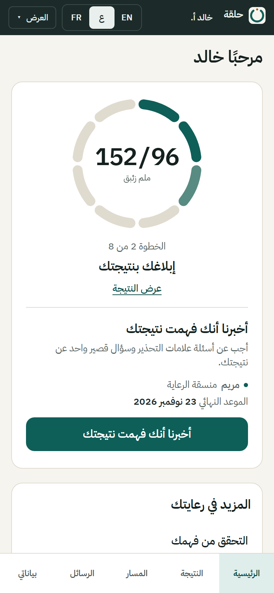
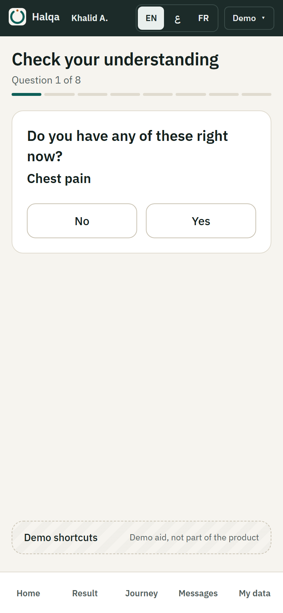
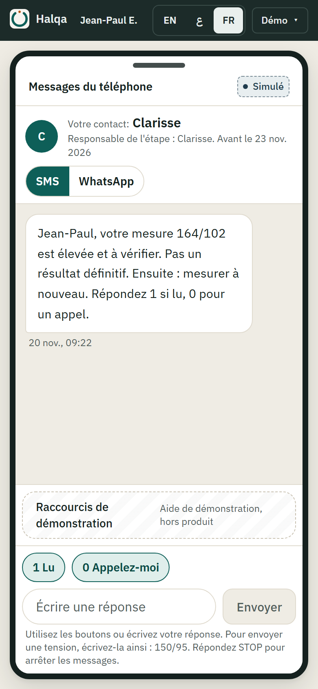
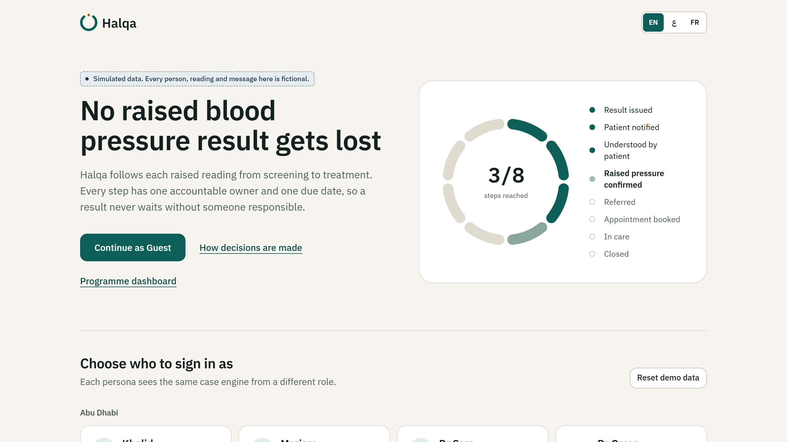
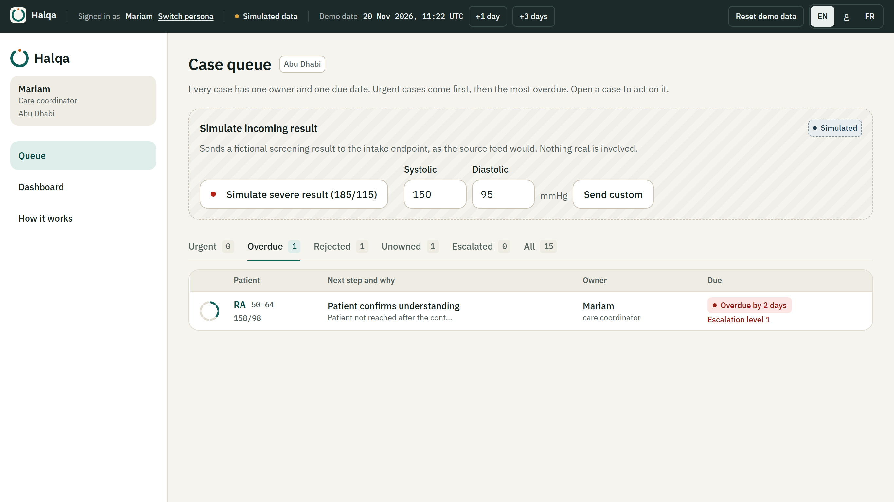
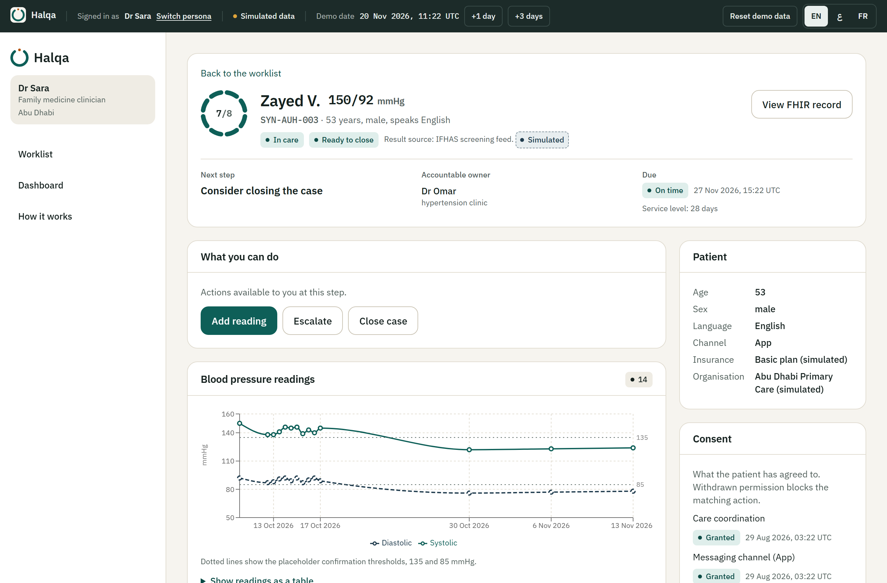
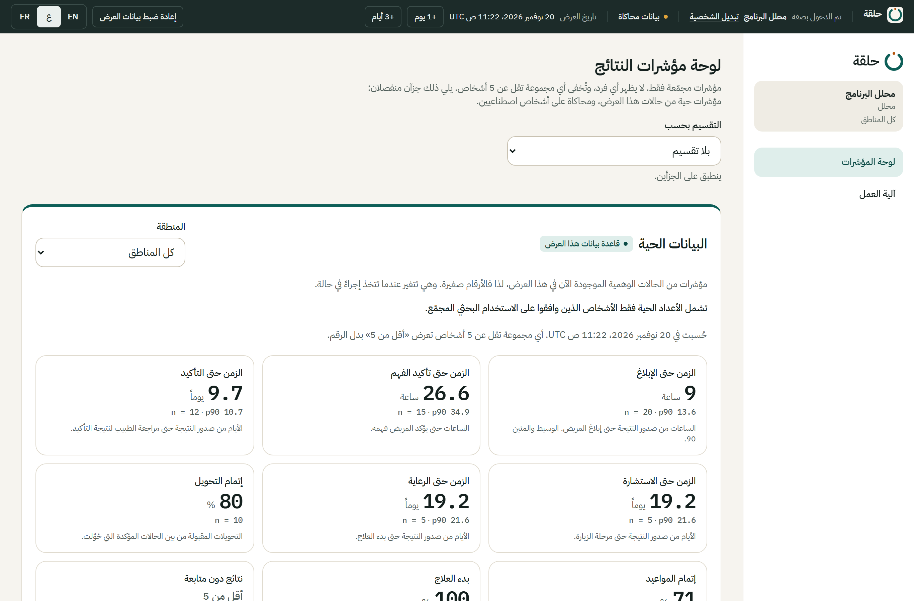
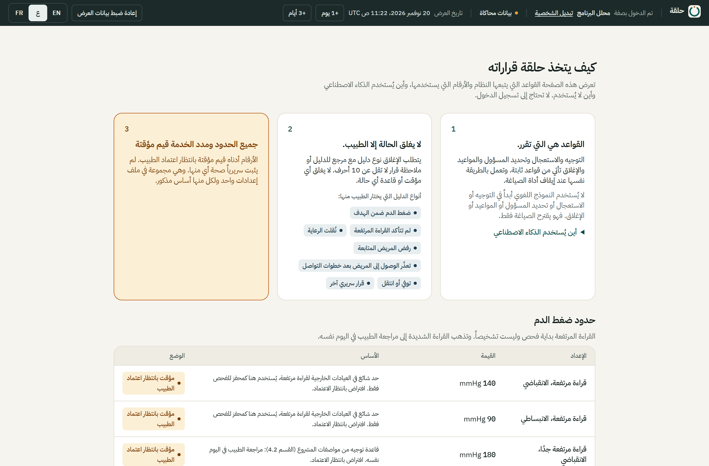

# Halqa

When a screening finds a raised blood pressure, the result is often issued and then nobody owns the next step: the patient may not understand it, referrals stall between providers, and nobody sees that a case is late. Halqa (Arabic for "loop") is a hackathon prototype that turns each raised reading into one case with eight states, one accountable owner and one due date at every step. Overdue, rejected and unowned cases show up in a coordinator queue, a severe reading creates a same-day clinician review, and only a clinician can close a case. After treatment starts, the patient gets one small weekly action that gets smaller, never harsher, when a week is missed.

It answers Future Health Digital Innovation Challenge, Population Health, Challenge 05 "Closing the Screening-to-Care Loop", with Challenge 09 lifestyle features as the follow-up stage. Entry by Team Latitude-IT. The entry is a public code repository plus a demonstration video. There is no hosted deployment.

## Screenshots

All screens show synthetic people and simulated data.

<table>
  <tr>
    <td align="center"><br>Patient home in Arabic, with the loop ring.</td>
    <td align="center"><br>Understanding check, one question at a time.</td>
    <td align="center"><br>Yaoundé phone thread in French.</td>
  </tr>
</table>



Landing page: choose a persona, all of them fictional.



Coordinator queue: every case has an owner, a due date and a reason it is listed.



Case detail: next step, readings, messages and the audit timeline.



Dashboard in Arabic: aggregate only, with small groups hidden, and simulated results clearly separate from live data.



Transparency page in Arabic: every threshold is shown with its placeholder status.

## How it meets the six points of the challenge

| Challenge point | In Halqa |
|---|---|
| End-to-end case visibility | One case per result, eight-step progress, a full audit timeline, a read-only FHIR bundle |
| Clear ownership and timely progression | Owner and due date on every step, overdue and escalation rules, an unreachable-patient protocol, coordinator queues |
| Patient-centred communication | Approved messages in English, Arabic and French, teach-back, a red-flag check, an SMS thread with simple replies, cover shown before booking, consent controls |
| Cross-provider consultation and coordination | Referral accept and reject with a reason, a rejected-referral queue, e-consults between clinicians |
| Safe, human-governed escalation | Rule-based severe classification, a parallel urgent review task, escalation to an on-call target, clinician-only closure |
| Closure and patient impact measures | A closure gate with evidence types, a live dashboard, and a simulated baseline against the loop |

## What is real and what is simulated

> - Every person, reading, provider and message is synthetic. There is no real personal data anywhere.
> - IFHAS, Malaffi, Thiqa, SMS and WhatsApp are simulated. Nothing is connected to a real system and no message is really delivered.
> - All thresholds and service levels are placeholders pending clinician sign-off. No clinician has reviewed the pathway.
> - Arabic and French text has not been reviewed by native-speaker clinical reviewers.
> - Outcome results come from a simulation on synthetic people, mostly using our own assumptions. They are not evidence of clinical effectiveness.
> - The optional AI re-wording was tested only with mocked HTTP calls and is off by default. Staff can send only stored, approved templates, never free text.
> - PostgreSQL support is configured but has not been exercised.
> - An independent scripted end-to-end run covered the three demo parts and ten cross-persona checks. It found defects, which were fixed. It did not cover every screen in every language.
> - The prototype is not a medical device and has not been assessed against any medical device regulation.

Real, with automated tests: the case engine, the closure gate, the audit log, the consent effects, the message validator and the simulation code.

## Run it in two commands

```
docker build -t halqa .
docker run -p 8000:8000 -e GUEST_TOKEN_SECRET=<any long random string> halqa
```

Then open `http://localhost:8000` and choose "Continue as Guest". The "Reset demo data" button on the landing page restores the seed. The demo bar has "+1 day" and "+3 days" buttons to move the demo clock. Set `DEMO_MODE=false` to switch off guest login, the clock, the reset and the intake simulator.

For development, the backend runs in Docker inside WSL through a helper script (`wsl -e bash /mnt/d/Projects/Hackathon/dev/run.sh build`, then `up 8000`), and the front end runs with `cd frontend`, `npm ci`, `npm run dev`. Full instructions and environment variables are in section 12 of the technical documentation.

## Demo personas

All are fictional.

| Persona | Who |
|---|---|
| Khalid (`patient_auh`) | 34, Abu Dhabi, flagged at a simulated screening, 152/96. Arabic or English |
| Mariam (`coordinator_auh`) | Care coordinator, Abu Dhabi. Works the queue |
| Dr Sara (`clinician_pcp`) | Family medicine. Reviews, refers, answers e-consults, closes |
| Dr Omar (`clinician_specialist`) | Hypertension clinic. Accepts or rejects referrals |
| Jean-Paul (`patient_yde`) | 47, Yaoundé, clinic reading 164/102. French, SMS and WhatsApp thread |
| Clarisse (`nurse_yde`) | Nurse coordinator, Yaoundé |
| Dr Brice (`clinician_yde`) | Primary care clinician, Yaoundé. Reviews urgent readings |
| Programme analyst (`analyst`) | Aggregate dashboard only |

## Guardrails

- Rules decide, AI only words messages. Routing, urgency, ownership, due dates and closure never read a language model's output, and a test checks that the engine does not import the wording code.
- Clinicians close cases. Only the clinician role can close, only with an evidence type plus a reference or a decision note, and no timer or rule can.
- Thresholds and service levels are placeholders that await clinician sign-off. They live in one config file and are labelled on screen.
- Synthetic data only. The dashboard is aggregate only and hides any group of fewer than 5 people.

## Documentation

- [Technical documentation](docs/TECHNICAL_DOCUMENTATION.md): architecture, case model, clinical boundaries, responsible AI, data, governance, simulation, interoperability, testing, assumptions and limitations, how to run.
- [Submission summary](docs/SUBMISSION_SUMMARY.md): the short version.
- [Safety case](docs/SAFETY_CASE.md): hazards, controls and residual risk.
- [Demo script](docs/DEMO_SCRIPT.md): script for the demonstration video.
- [Data card](backend/data/DATA_CARD.md): how the synthetic data is generated.
- [Diagrams](docs/diagrams/diagrams.md): architecture, lifecycle, severe escalation, AI boundary, closure gate.
- [Specification](docs/SPEC.md) and [decisions log](docs/DECISIONS.md): the build contract and the recorded deviations.
- [Third-party notices](THIRD_PARTY_NOTICES.md): open-source dependencies and licences.

## Repository map

`backend/app/engine` (pure rule engine and `config.yaml`), `backend/app/api` (routes, send function, reply grammar), `backend/app/wording` (templates and validator), `backend/app/fhir`, `backend/app/sim` (synthetic cohort and simulation), `backend/app/demo`, `backend/app/db`, `backend/data`, `backend/tests` and `backend/tests_data_ai`, `frontend/src`, `docs`, `dev`, and the production `Dockerfile`.

## Tests and CI

```
wsl -e bash /mnt/d/Projects/Hackathon/dev/run.sh test tests tests_data_ai -q
```

On 2026-11-20 this gave ``525 passed, 1 warning in 169.56s (0:02:49)``. The tests cover the engine, the API, messaging, consent, localisation, the wording validator and the simulation. There is no front-end test suite. Without WSL, the same suite runs with `cd backend`, `pip install -r requirements.txt`, `python -m pytest tests tests_data_ai -q`.

The production Docker image was built from this code and run by the team on 20 November 2026: the container runs as a non-root user, the health check answers, the app is served at `/` and guest sign-in works. The GitHub Actions workflow (`.github/workflows/ci.yml`) runs the backend tests and the front-end build on every push.

## Synthetic data statement

All data in this repository is synthetic and generated by our own seeded code. No real patient, clinician or personal data was used. Names, phone numbers and organisations in the demo are invented. Names of real organisations appear only as labels of simulated sources.

Licence: to be confirmed by the team
