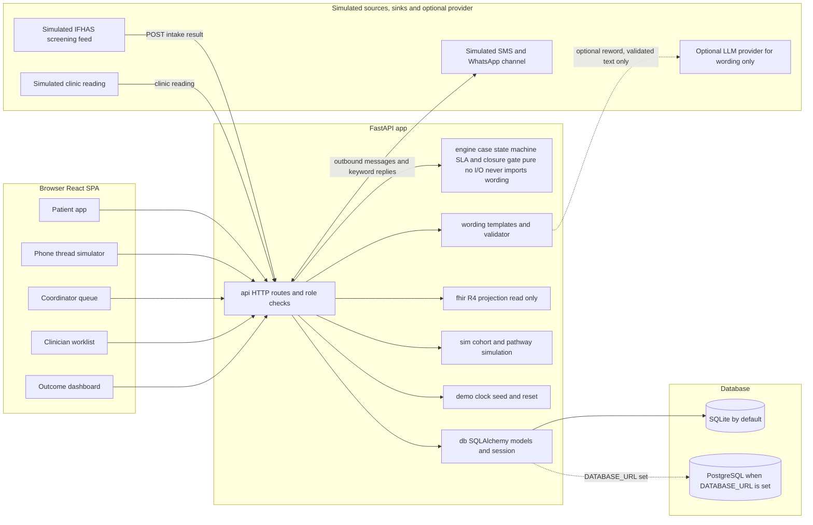
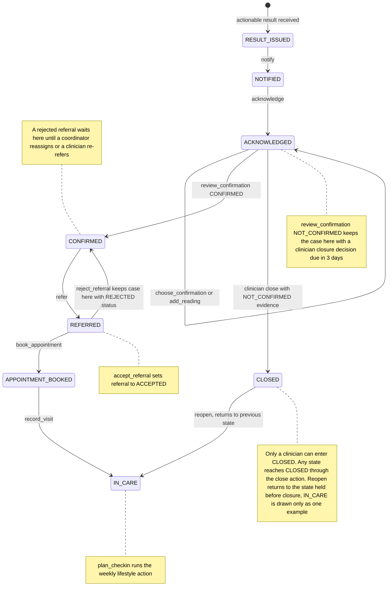
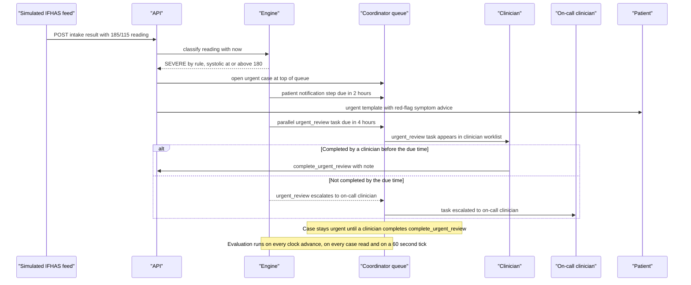
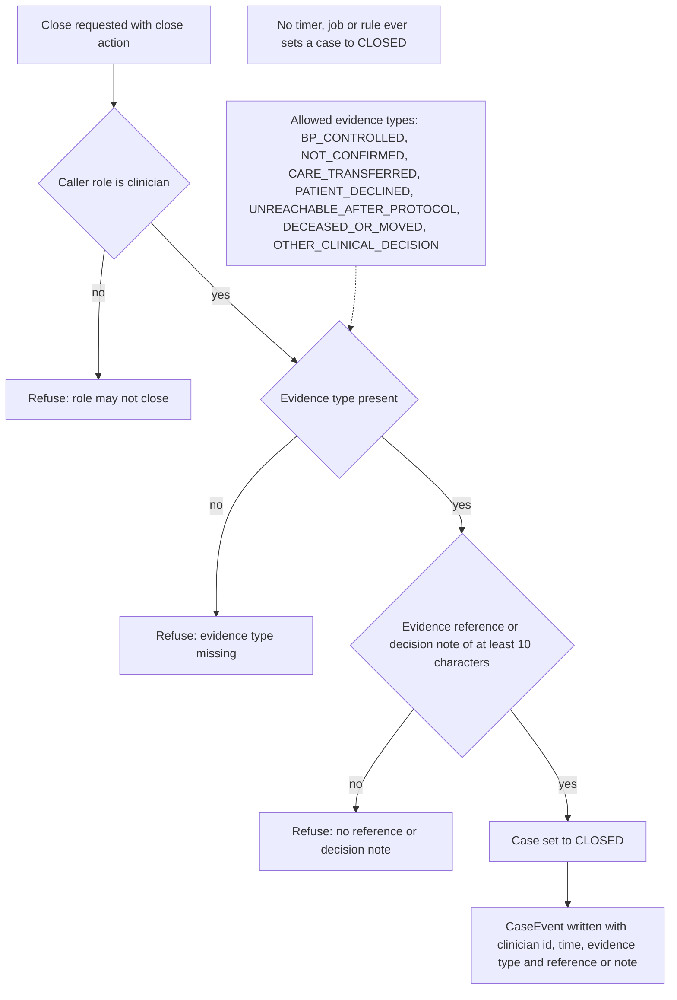
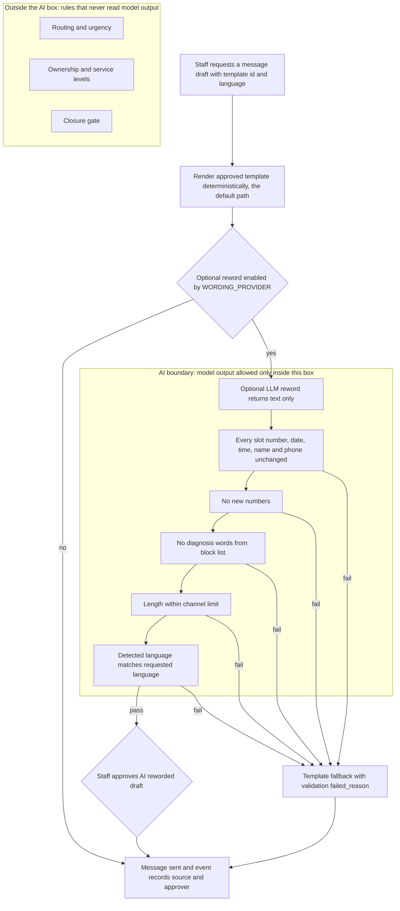

# Halqa: technical documentation

Future Health Digital Innovation Challenge, Population Health, Challenge 05 "Closing the Screening-to-Care Loop". Team Latitude-IT. Hackathon prototype.

This document describes what the code in this repository does on the date of writing (2026-11-18). Where the original specification (`docs/SPEC.md`) and the code differ, this document follows the code and says so. Nothing here has been clinically validated. Every person, reading, provider and message in the system is synthetic.

Contents: 1 Summary, 2 System architecture, 3 Case model, 4 Clinical boundaries, 5 Responsible AI, 6 Data, 7 Data governance and privacy, 8 Outcome measures and simulation, 9 Interoperability and path to deployment, 10 Testing and verification, 11 Assumptions and limitations, 12 How to run.

## 1. Summary

### The problem

A raised blood pressure found at a screening event often does not turn into care. The result is issued, but nobody owns the next step, nobody is told it is late, the patient may not understand it, and the referral can stall between providers. Four published figures frame the problem, as cited in the team's evidence register. We have not re-checked them against their sources:

- Over 40% of people with hypertension in a 2025 UAE screening campaign did not know it, and 29% of treated patients were not at target (MOHAP, reported by Gulf News).
- 25.9% of UAE adults have high blood pressure (National Health and Nutrition Survey 2024 to 2025).
- Overdue lists and calls cut 3-month missed visits from 50% to 26% in six months (Simple app, Bangladesh).
- Text messaging roughly halved the odds of uncontrolled blood pressure (Tam et al., JMIR mHealth 2021).

### What the prototype does

Halqa turns one raised screening reading into one case. The case moves through eight states. At every state it has one accountable owner and one due date. Overdue, rejected and unowned cases show up in a coordinator queue. A severe reading creates a same-day clinician review task. Only a clinician can close a case, and only with an evidence type plus an evidence reference or a written decision. After treatment starts, the patient gets one small weekly diet or activity action. A missed week makes the plan smaller. It never resets or penalises.

Two settings share one rule engine:

- Abu Dhabi: the result arrives from a simulated IFHAS screening feed. The patient uses a web app in Arabic or English. Insurance cover is shown before booking (simulated).
- Yaounde: the result arrives from a clinic reading. The patient is served by SMS and WhatsApp, shown as a phone-style thread in French. A nurse is the coordinator.

### What is real and what is simulated

| Real, in this repository | Simulated or not done |
|---|---|
| The case state machine, owners, due dates, queues, escalation and closure gate, as code with automated tests | Any clinical review of the pathway, thresholds or service levels. All of them are placeholders pending clinician sign-off |
| Approved message templates in English, Arabic and French, deterministic rendering | Review of the Arabic and French text by native-speaker clinical reviewers |
| A validator for optionally re-worded text, and the staff approval step | Any live call to an AI provider. The provider code was tested only with mocked HTTP calls and is off by default |
| A read-only FHIR R4B projection of a case, validated with the `fhir.resources` library | Any connection to IFHAS, Malaffi, Thiqa, an SMS gateway or a WhatsApp gateway. All are simulated |
| An audit log that the application cannot update or delete | Production identity, encryption at rest, key management, retention policy, data residency |
| A live dashboard computed from the cases in the database | Evidence of clinical effect. The seeded demo cases are constructed |
| A seeded Monte Carlo simulation on a synthetic population, with all inputs listed | Realism of the simulation inputs. Almost all are our own assumptions |
| SQLite storage | PostgreSQL. It is configured in code but was not exercised |

### The six solution points of the challenge

| Challenge point | Feature in the prototype | Main code |
|---|---|---|
| End-to-end case visibility | One case per raised result, eight-step progress, full timeline from the audit log, FHIR bundle of the case | `backend/app/engine/states.py`, `backend/app/api/projection.py`, `backend/app/db/models.py` (CaseEvent), `backend/app/fhir/bundle.py` |
| Clear ownership and timely progression | Next step, owner role, owner user and due date on every case. Overdue flag, escalation levels, unreachable-patient protocol, coordinator queues | `backend/app/engine/sla.py`, `backend/app/engine/queues.py`, `backend/app/api/core.py` (`refresh_case`, `tick_all`), `backend/app/main.py` (60 second tick) |
| Patient-centred communication | Plain-language result in three languages, teach-back with a simpler second explanation, red-flag check, SMS and WhatsApp thread with numbered replies, cover shown before booking, patient consent controls | `backend/app/wording/`, `backend/app/api/intake.py` (`handle_reply`), `backend/app/api/routes.py` (slots and cover, messages) |
| Cross-provider consultation and coordination | Referral with accept and reject, a rejected-referral queue, e-consults between clinicians, sharing consent that blocks referral when withdrawn | `backend/app/engine/actions.py`, `backend/app/api/actions_impl.py` (`do_refer` and related), `backend/app/api/routes.py` (e-consults) |
| Safe, human-governed escalation | Rule-based severe classification, parallel urgent review task, escalation to an on-call clinician target, red-flag symptom check, clinician-only closure | `backend/app/engine/urgency.py`, `backend/app/engine/sla.py`, `backend/app/engine/closure.py` |
| Closure and patient impact measures | Closure gate with evidence types, live dashboard measures, simulated baseline versus with-loop results, small-cell suppression | `backend/app/api/dashboard.py`, `backend/app/sim/` |

## 2. System architecture

### Components

One deployable container holds everything. A FastAPI application serves the JSON API under `/api` and also serves the built React single-page app at `/` (see `backend/app/main.py`).



| Layer | What it is | Where |
|---|---|---|
| Front end | React, Vite, TypeScript, Tailwind CSS, React Router, TanStack Query, i18next with English, Arabic (right to left) and French, Recharts | `frontend/src` |
| API | FastAPI routes, role checks, request and response schemas. OpenAPI at `/api/openapi.json` | `backend/app/api/` |
| Engine | State machine, action table, urgency rules, service levels and escalation, closure gate, lifestyle plan rules | `backend/app/engine/` |
| Wording | Approved templates, deterministic rendering, optional AI re-wording with validator | `backend/app/wording/` |
| FHIR | Read-only projection of a case to a FHIR Bundle | `backend/app/fhir/bundle.py` |
| Simulation | Synthetic cohort generator and pathway simulation, run offline, results stored as JSON | `backend/app/sim/`, `backend/data/` |
| Demo | Demo clock, seeded scenarios, reset | `backend/app/demo/` |
| Database | SQLAlchemy 2 models. SQLite file by default, PostgreSQL when `DATABASE_URL` is set | `backend/app/db/` |

### Module boundaries and why they exist

1. The engine is pure. It does no database or network access and takes the current time as an argument (`evaluate(case, now)`). It reads `engine/config.yaml` once and caches it. The API builds a `CaseData` snapshot from database rows, asks the engine what is allowed and what is due, and writes the result. Reason: the same rules must give the same answer in a test, in the demo and in a pilot. A pure function with injected time can be tested at the boundaries (for example exactly at a service level) without waiting. It also keeps clinical rules readable in one small package of about 800 lines.
2. Wording is isolated from decisions. The engine never imports the wording module, the wording module never imports the engine, the API or the database, and the API reaches wording only through `backend/app/api/wording_port.py`. If the wording module is missing, the port falls back to built-in English text and the engine behaves the same. Reason: any language model output must have no path into routing, urgency, ownership, service levels or closure.
3. FHIR is a projection. `fhir/bundle.py` reads rows and builds a bundle. It does not write to the case. Reason: the internal model can change without breaking an exchange format, and no outside system can change a case through it.
4. Time is a demo clock. The API reads time from `backend/app/demo/clock.py`, which is real time plus an offset stored in the database. A judge can add one or three days and watch a case become overdue. The engine never reads this clock itself.
5. Configuration is one file. Every threshold and service level is in `backend/app/engine/config.yaml` with a value, unit, basis and status. The same file is served at `GET /api/config` and shown on the transparency page.

### How a request flows

1. The caller sends `POST /api/cases/{id}/actions` with an action name and a payload. This is the only way case state changes.
2. The API loads the case, checks the caller may see it, and builds a `CaseData` snapshot.
3. The engine checks role first (403) and state or rule second (409). The payload is validated after that (422).
4. The handler in `backend/app/api/actions_impl.py` applies the change and writes an audit event.
5. The engine evaluates the case at `now`. New effects (escalations, reminders, tasks) are written. The evaluation compares against counters stored on the case, so it never repeats an effect.
6. Evaluation also runs on every case read, on every demo clock advance and on a 60 second background task in the process (`tick_loop` in `main.py`).

### Sequence diagrams and state diagram

The case lifecycle (the action that causes each move is written on the arrow):



The severe reading path. The 185/115 example is the demo button "Simulate incoming severe result":



Two more diagrams are in `docs/diagrams/diagrams.md`: the ownership and service level table (diagram 3) and the standard patient journey (diagram 5).

### User interface

<!-- LEAD: confirm screens after integration -->

The screens are specified in SPEC section 10. This section describes the shell that exists in `frontend/src` and the intended screens. Whether each screen works end to end has not been verified by the author of this document.

What the shell provides (read from `frontend/src`):

- A landing page with "Continue as Guest", a persona picker with the seven personas and a "Reset demo data" control (`routes/Landing.tsx`).
- A persistent demo bar with the current persona, the demo clock, a "Simulated data" tag and a language switch (`components/DemoBar.tsx`).
- Routes by role (`App.tsx`): `/patient/*` and `/phone/*` for patients, `/staff/queue` for coordinators, `/staff/worklist` for clinicians, `/staff/cases/:id` for both, `/dashboard` for coordinators, clinicians and the analyst, and a public `/transparency` page.
- Three languages with right-to-left layout for Arabic, and a shared component library.
- Types generated from the checked-in OpenAPI file (`npm run gen:api`).

Intended screens (SPEC section 10): a mobile-first patient app (plain-language result, red-flag check, teach-back, eight-step journey, confirmation choice, home reading entry with running average, referral and appointment status, slot booking with cover shown first, weekly action and check-in, messages, consent settings, "how my data is used"); a Yaounde phone-thread simulator in French; a coordinator queue with tabs and a case detail with timeline, owner reassignment and message draft and approve; a clinician worklist with confirmation review, refer, accept or reject, e-consult thread, closure dialog and a FHIR drawer; a dashboard with live and simulated measures, a split selector, "fewer than 5" display and a parameters panel; and a transparency page listing thresholds, the AI rule and the closure rule.

Design intent that a reviewer can check on the screens: calm clinical palette, no red on the patient lifestyle screens, Latin digits for clinical values in all languages, `lang` and `dir` set per language. No accessibility audit has been done (see section 11).

## 3. Case model

### The eight states

`state` is the last milestone reached. `next_step` is the one thing that must happen next, who is accountable, and when it is due. The next step is calculated by `next_step()` in `backend/app/engine/sla.py`. Service levels come from `config.yaml` and are placeholders.

| # | State | Next step (label key) | Accountable owner role | Service level |
|---|---|---|---|---|
| 1 | `RESULT_ISSUED` | Notify the patient (`notify_patient`) | coordinator | 24 h, 2 h if the case is severe |
| 2 | `NOTIFIED` | Patient acknowledges and passes teach-back (`patient_acknowledge`) | coordinator (the patient acts) | 72 h |
| 3 | `ACKNOWLEDGED` | Choose method, complete home readings or attend ambulatory monitoring, then clinician review (`choose_confirmation_method`, `complete_home_readings`, `attend_abpm`, `clinician_review_confirmation`) | primary care clinician | 14 days |
| 4 | `CONFIRMED` | Send referral (`send_referral`). If a referral was rejected and nobody owns the case: `reassign_or_rerefer` | clinician. Coordinator for a rejected referral | 3 days |
| 5 | `REFERRED` | Receiving clinician accepts (`accept_referral`), then the appointment is booked (`book_appointment`) | receiving clinician until accepted, then coordinator (the patient acts) | 2 days to accept, 5 days to book |
| 6 | `APPOINTMENT_BOOKED` | Visit happens and outcome recorded (`record_visit_outcome`) | receiving clinician | appointment time plus 24 h |
| 7 | `IN_CARE` | Four week review (`four_week_review`), or `consider_closure` when the last three clinic readings are at target. The weekly lifestyle action runs here | treating clinician | 28 days |
| 8 | `CLOSED` | none | none | none |

Transitions are data in `backend/app/engine/states.py`. Moves are made only by actions: `notify`, `acknowledge`, `review_confirmation` (outcome CONFIRMED), `refer`, `reject_referral`, `book_appointment`, `record_visit`, `close` and `reopen`. `choose_confirmation`, `add_reading` and `accept_referral` change the next step but not the state.

### Owners, queues and sub-status

- Every case has `owner_role` and, where assigned, `owner_user_id`. A case with no owner user while a human step is due is unowned.
- Queues (`backend/app/engine/queues.py`): `all`, `urgent`, `overdue`, `rejected`, `unowned`, `escalated`, `mine`. Closed cases are in no queue except `all`. A rejected case is not also listed as unowned. Lists sort urgent first (severe before red-flag), then most overdue, then soonest due.
- Referral sub-status is `PENDING`, `ACCEPTED` or `REJECTED`. A rejection returns the case from `REFERRED` to `CONFIRMED`, keeps the earlier milestone times, clears the owner, records the reason and puts the case in the rejected queue. `assign_owner` takes it out of that queue. A clinician can also re-refer directly.
- If confirmation readings do not support a raised average, the clinician can record NOT_CONFIRMED. The case stays in `ACKNOWLEDGED`, the suggested closure type becomes NOT_CONFIRMED, and the next step is a clinician closure decision due in 3 days. Nothing closes automatically.

### Urgent review task

A severe reading (see section 4) sets the case urgent and creates a separate `URGENT_REVIEW` task for the clinician role, due in 4 hours. The case's own next step stays on the normal pathway. If no clinician completes the task by its due time, the engine records an escalation to the on-call clinician target. The case stays urgent until a clinician runs `complete_urgent_review` with a note, or closes the case. A patient reporting a red-flag symptom, or a severe reading entered later, also flags the case urgent.

### Escalation levels

For the current step, level 1 starts at the due time and targets the owner. Level 2 starts at 2 times the service level and targets the "coordinator lead". For severe cases level 2 starts at 1 times the service level and targets the "on-call clinician". These two targets are labels on the escalation event and in the queue. The prototype has no on-call roster and does not page anyone. A coordinator or clinician can also escalate manually, which sets level 2.

### Unreachable-patient protocol

Applies when the person who must act is the patient. Each stage runs once, measured from the start of the step:

| Hours after step start | Effect |
|---|---|
| 24 | Reminder message in the patient's channel |
| 48 | Reminder on the other channel |
| 72 | Coordinator call task |
| 120 | Case flagged for a clinician decision, with suggested closure type UNREACHABLE_AFTER_PROTOCOL |

The 24, 48 and 72 hour stages come from the specification. The 120 hour stage is our own assumption. The case is never closed by this protocol (test `test_protocol_exhausted_never_closes`). The reminder text is the acknowledgement reminder template whichever patient step is late (see section 11).

### Audit log

`CaseEvent` holds one row per transition, message, escalation, task, owner change, consent change, e-consult, staff read, closure and reopen. Fields: id, case, time, actor, actor role, type, from state, to state, payload and reason. The case timeline in the interface is this log.

Append-only is enforced in the ORM. Two SQLAlchemy listeners in `backend/app/db/models.py` raise `AppendOnlyError` on any update or delete of a `CaseEvent` row, and no application code attempts either. The test `test_case_events_are_append_only` checks both. This is not a database-level control. A person with direct database access could still change rows, and the demo reset drops and recreates the schema, which removes events. A production deployment would need database permissions that forbid update and delete on this table, and ideally tamper evidence. That is not implemented.

Staff reads are logged. Opening a case detail or its FHIR bundle writes a `CASE_VIEWED` event. Case list reads and a patient reading their own case do not.

### Reopen

A clinician can reopen a closed case with a reason of at least 5 characters (a value in `config.yaml`, an assumption). The case returns to the state held just before closure (`state_before_close`), closure fields are cleared from the case row (the closure event stays in the log), and the next step gets a fresh due date counted from the reopen time.

## 4. Clinical boundaries

### What the system is and is not

- Screening is not diagnosis. A screening reading is called "a raised reading that needs checking". The patient-facing templates say it is not a final result and does not mean the person is ill. A blocked-word list (`backend/app/wording/blocked_words.yaml`) covers diagnosis and alarm words in three languages, and a test checks that our own templates contain none.
- The prototype is not a medical device. It has not been assessed against any medical device regulation. It is a coordination and communication prototype that applies configurable rules to numbers. It does not interpret, diagnose or recommend treatment.
- All thresholds and service levels need clinician sign-off before any pilot.

### What the system decides by rule

| Decision | Rule | Code |
|---|---|---|
| Whether a reading opens a case | Systolic at or above 140, or diastolic at or above 90 (placeholder values) | `engine/urgency.py` `classify` |
| Whether a reading is severe | Systolic at or above 180, or diastolic at or above 110 | `engine/urgency.py` `classify` |
| Who owns the next step and when it is due | Table in section 3 | `engine/sla.py` |
| Whether a step is overdue and escalated | Service levels and multipliers in config | `engine/sla.py` |
| What the confirmation average shows | Home and ambulatory rules below. This is advice to the clinician, not a diagnosis | `engine/urgency.py` |
| Whether the "ready to close" prompt shows | Last three clinic readings all below the target values | `engine/urgency.py` `at_target` |
| The size of next week's lifestyle action | Plan rules below | `engine/plan.py` |

### What the system never decides

The system does not diagnose, choose or change treatment, decide whether a referral is needed, decide that a person is well, decide to close a case, or read any free text from a patient. A clinician makes every referral, review and closure decision. The engine's confirmation average does not bind the clinician: a clinician can record CONFIRMED when the average is below threshold, provided there are enough readings, and can record NOT_CONFIRMED at any time.

### Severe readings and red-flag advice

- A severe index reading opens the case as urgent, sends the severe template with red-flag symptom advice automatically (system actor, case goes to `NOTIFIED`), and creates the 4 hour urgent review task.
- A severe reading added later by any permitted source sets the case severity to SEVERE, flags it urgent and returns emergency advice text in the API response.
- At acknowledgement the patient can report any of six symptoms: chest pain, shortness of breath, severe headache, vision change, confusion, one-sided weakness. Any one flags the case urgent and returns the emergency advice.
- Emergency advice is region configuration in `backend/app/api/regions.py`. For Abu Dhabi it says to call 998 for an ambulance. For Yaounde it says to go to the nearest emergency department, with no number. The number 998 is taken from the project specification. It has not been checked against an official source.
- Known gap: in the SMS thread, the reply parser stores a home reading through the normal path, so a severe reading sent by SMS flags the case and creates the clinician task, but the code replies with the generic "we received your reply" text and not emergency advice. The red-flag question is also not asked in the SMS thread. See section 11 and `docs/SAFETY_CASE.md`.

### Confirmation by home or ambulatory monitoring

Blood pressure values come only from a validated home cuff (`HOME_CUFF`), a clinic measurement (`CLINIC`) or an ambulatory monitor (`ABPM`). There is no wearable source (see below).

- Home monitoring: a day counts if it has at least 2 home readings. At least 4 such days are needed, counting the first. The first qualifying day is discarded and the rest are averaged. An average at or above 135 systolic or 85 diastolic is "confirmed raised". Fewer than 4 qualifying days gives "insufficient", never "not confirmed". The clinician cannot record CONFIRMED while the status is insufficient.
- Ambulatory monitoring: readings between 07:00 and 22:00 count as daytime. At least 14 daytime readings are needed. A daytime average at or above 135/85 is "confirmed raised".
- Days and the daytime window are taken from UTC timestamps without converting to local time. This is a known simplification (section 11).

### Clinician-only closure

`close` is allowed only for the clinician role and from any open state (`engine/actions.py`). The closure gate (`engine/closure.py`) refuses the request unless it has an evidence type from the list and either an evidence reference or a decision note of at least 10 characters. Evidence types: `BP_CONTROLLED`, `NOT_CONFIRMED`, `CARE_TRANSFERRED`, `PATIENT_DECLINED`, `UNREACHABLE_AFTER_PROTOCOL`, `DECEASED_OR_MOVED`, `OTHER_CLINICAL_DECISION`. The gate checks that a note exists and is long enough. It cannot judge whether the note is sensible. No timer, job or rule has a path to `CLOSED`: `producers_of_closed()` in `engine/states.py` must return exactly `{close}`, and a test asserts that.



### Lifestyle plan rules (Challenge 09 follow-up stage)

Runs in `IN_CARE`, only when the patient's `lifestyle_programme` consent is on, and starts when a visit is recorded. Code in `backend/app/engine/plan.py`.

- One action per week from four: salt, activity, sleep, home blood pressure check. Three sizes each: full, smaller, smallest.
- Weekly check-in: done, partly or missed, with an optional barrier from a short list (time, cost, not sure how, felt unwell, work schedule, other).
- Missed: next week is one size smaller (not below smallest) and the patient receives the no-blame check-in message. Partly twice in a row: one size smaller. Done: the action rotates and, after two done weeks in a row, a larger size is offered. The patient chooses whether to accept. It is never imposed.
- Three missed weeks in a row create a human task for the coordinator, "offer a call". No message is sent for it.
- A week with no check-in 8 days after it starts (7 days plus 1 day grace) is recorded as missed by the background evaluation, with no blame message.
- No streak counter exists. No lapse resets history. A test (`test_no_penalty_language_in_plan_texts`) checks that one patient flow contains none of the words streak, failed, penalty, lost or reset.

### Wearable data is a diary only

The reading source list has no wearable value. Sending `WEARABLE` as a source returns 422 (test `test_wearable_is_not_a_blood_pressure_source`). The diary endpoint serves a sample 14 day activity and sleep series from `backend/data/demo_series.json` with a field `wearable_used_for_bp` that is always false. The sample contains no blood pressure fields (test `test_demo_series_meet_spec`). No real device is connected.

### Thresholds and service levels

All 41 entries in `backend/app/engine/config.yaml` are listed below. Every entry has the status `placeholder_pending_clinician_signoff` (a test checks this, `test_every_config_entry_is_a_labelled_placeholder`). The word "Basis" is as written in the file. Most entries say the number comes from the project specification, which means the team chose it. No external clinical source has been checked for any of them. They need clinician sign-off before any pilot, and none is claimed to be clinically validated.

| Entry | Value | Unit | Basis (as written in the file) | Status |
|---|---|---|---|---|
| `thresholds.raised_systolic` | 140 | mmHg | Common outpatient cut-off for a raised reading, used here as a screening trigger only. Assumption pending sign-off. | Placeholder, pending clinician sign-off |
| `thresholds.raised_diastolic` | 90 | mmHg | Common outpatient cut-off for a raised reading, used here as a screening trigger only. Assumption pending sign-off. | Placeholder, pending clinician sign-off |
| `thresholds.severe_systolic` | 180 | mmHg | Routing rule from the project specification (section 4.2): same-day clinician review. Assumption pending sign-off. | Placeholder, pending clinician sign-off |
| `thresholds.severe_diastolic` | 110 | mmHg | Routing rule from the project specification (section 4.2): same-day clinician review. Assumption pending sign-off. | Placeholder, pending clinician sign-off |
| `thresholds.hbpm_systolic` | 135 | mmHg | Home blood pressure average threshold from the project specification. Assumption pending sign-off. | Placeholder, pending clinician sign-off |
| `thresholds.hbpm_diastolic` | 85 | mmHg | Home blood pressure average threshold from the project specification. Assumption pending sign-off. | Placeholder, pending clinician sign-off |
| `thresholds.hbpm_min_days` | 4 | days | Days with enough readings, counting the discarded first day. Assumption pending sign-off. | Placeholder, pending clinician sign-off |
| `thresholds.hbpm_min_readings_per_day` | 2 | readings | Minimum readings for a day to count. Assumption pending sign-off. | Placeholder, pending clinician sign-off |
| `thresholds.abpm_daytime_systolic` | 135 | mmHg | Daytime ambulatory average threshold from the project specification. Assumption pending sign-off. | Placeholder, pending clinician sign-off |
| `thresholds.abpm_daytime_diastolic` | 85 | mmHg | Daytime ambulatory average threshold from the project specification. Assumption pending sign-off. | Placeholder, pending clinician sign-off |
| `thresholds.abpm_daytime_start_hour` | 7 | hour of day (UTC) | Assumption: daytime window used for the ambulatory average. | Placeholder, pending clinician sign-off |
| `thresholds.abpm_daytime_end_hour` | 22 | hour of day (UTC) | Assumption: daytime window used for the ambulatory average. | Placeholder, pending clinician sign-off |
| `thresholds.abpm_min_daytime_readings` | 14 | readings | Assumption: minimum daytime readings for a usable ambulatory recording. | Placeholder, pending clinician sign-off |
| `thresholds.target_systolic` | 130 | mmHg | Assumption: a clinic reading below this and below the diastolic target counts as at target for the ready-to-close prompt. | Placeholder, pending clinician sign-off |
| `thresholds.target_diastolic` | 80 | mmHg | Assumption: see target_systolic. | Placeholder, pending clinician sign-off |
| `thresholds.target_consecutive_readings` | 3 | readings | Project specification (scenario ready_to_close): last three clinic readings at target. Assumption pending sign-off. | Placeholder, pending clinician sign-off |
| `service_levels.result_issued` | 24 | hours | Project specification section 4.1. Placeholder pending sign-off. | Placeholder, pending clinician sign-off |
| `service_levels.result_issued_severe` | 2 | hours | Project specification section 4.1. Placeholder pending sign-off. | Placeholder, pending clinician sign-off |
| `service_levels.urgent_review` | 4 | hours | Same-day clinician review of a severe reading, project specification section 4.2. Placeholder pending sign-off. | Placeholder, pending clinician sign-off |
| `service_levels.notified` | 72 | hours | Project specification section 4.1. Placeholder pending sign-off. | Placeholder, pending clinician sign-off |
| `service_levels.acknowledged` | 14 | days | Project specification section 4.1. Placeholder pending sign-off. | Placeholder, pending clinician sign-off |
| `service_levels.confirmed` | 3 | days | Project specification section 4.1. Placeholder pending sign-off. | Placeholder, pending clinician sign-off |
| `service_levels.closure_decision` | 3 | days | Clinician closure decision after a not-confirmed review, project specification section 4.1 clarifications. Placeholder pending sign-off. | Placeholder, pending clinician sign-off |
| `service_levels.referral_accept` | 2 | days | Project specification section 4.1. Placeholder pending sign-off. | Placeholder, pending clinician sign-off |
| `service_levels.appointment_booking` | 5 | days | Project specification section 4.1. Placeholder pending sign-off. | Placeholder, pending clinician sign-off |
| `service_levels.visit_outcome` | 24 | hours | Hours after the appointment time, project specification section 4.1. Placeholder pending sign-off. | Placeholder, pending clinician sign-off |
| `service_levels.in_care_review` | 28 | days | Review at 4 weeks, project specification section 4.1. Placeholder pending sign-off. | Placeholder, pending clinician sign-off |
| `escalation.level2_multiplier` | 2 | x service level | Project specification section 4.3. Placeholder pending sign-off. | Placeholder, pending clinician sign-off |
| `escalation.level2_multiplier_severe` | 1 | x service level | Project specification section 4.3. Placeholder pending sign-off. | Placeholder, pending clinician sign-off |
| `unreachable_protocol.reminder_after` | 24 | hours | Project specification section 4.3. Placeholder pending sign-off. | Placeholder, pending clinician sign-off |
| `unreachable_protocol.second_channel_after` | 48 | hours | Project specification section 4.3. Placeholder pending sign-off. | Placeholder, pending clinician sign-off |
| `unreachable_protocol.call_task_after` | 72 | hours | Project specification section 4.3. Placeholder pending sign-off. | Placeholder, pending clinician sign-off |
| `unreachable_protocol.clinician_decision_after` | 120 | hours | Assumption: two days after the call task, the case is flagged for a clinician decision. It is never closed automatically. | Placeholder, pending clinician sign-off |
| `closure.note_min_chars` | 10 | characters | Project specification section 4.1: minimum length of a recorded decision note. | Placeholder, pending clinician sign-off |
| `closure.reopen_reason_min_chars` | 5 | characters | Assumption: a reopen needs a short stated reason. | Placeholder, pending clinician sign-off |
| `teach_back.failures_before_call_task` | 2 | wrong answers | Project specification section 6: two wrong answers create a coordinator call task. | Placeholder, pending clinician sign-off |
| `lifestyle_plan.week_length` | 7 | days | Weekly action. | Placeholder, pending clinician sign-off |
| `lifestyle_plan.lapse_grace` | 1 | days | Assumption: a week with no check-in after this grace period is recorded as missed, with no blame. | Placeholder, pending clinician sign-off |
| `lifestyle_plan.partly_in_row_to_shrink` | 2 | check-ins | Project specification section 4.6. | Placeholder, pending clinician sign-off |
| `lifestyle_plan.done_in_row_to_offer_larger` | 2 | check-ins | Project specification section 4.6. | Placeholder, pending clinician sign-off |
| `lifestyle_plan.missed_in_row_for_call_task` | 3 | check-ins | Project specification section 4.6. | Placeholder, pending clinician sign-off |

## 5. Responsible AI

### Where a language model can be used

In one place only: re-wording approved template text. Everything else is code and rules. The model never receives a patient question, never sees a patient reply, and never produces anything the engine reads.



### How it works

1. Every message starts from a deterministic render of an approved template (`wording.render`). There are 25 template files, each with a version, purpose, channel limits, required slots and text in English, Arabic and French. Short SMS variants exist for the phone thread.
2. Re-wording is off unless `WORDING_PROVIDER` is `azure_openai` or `anthropic`. The default is `none`, which makes no network call (test `test_default_provider_makes_no_network_call`).
3. Even when a provider is set, re-wording is only attempted for a draft that staff request through `POST /api/cases/{id}/messages/draft` with a `tone`. Messages that the system sends itself (the severe notice, reminders, the referral and appointment notices, the weekly plan messages and the SMS replies) are always template text.
4. The provider call is a plain HTTP request with a 10 second timeout. The system prompt tells the model to keep the meaning, add no facts, advice, numbers or diagnoses, and keep every number, date, time, name and phone value unchanged.
5. The candidate text is accepted only if all six checks in `backend/app/wording/validator.py` pass:
   - not empty;
   - every slot value that appears in the approved text is still present, unchanged;
   - no digit string that was not in the approved text, including Arabic-Indic digits;
   - no word from the blocked list for that language;
   - length within the channel limit (the draft route passes no channel limit, so the limit is 1.25 times the template length plus 10);
   - the script matches the language (Arabic share at least 0.8 for Arabic; no Arabic for English or French; a simple stopword check separates English from French).
6. If any check fails, the template text is used and the response carries the failed reason. All checks always run, so a reviewer sees every result.
7. An AI re-worded draft cannot be sent without staff approval. `POST /api/cases/{id}/messages/send` returns 409 `APPROVAL_REQUIRED` unless `approve` is true. The sent message and its audit event record the source (`TEMPLATE` or `AI_REWORDED`), the approver and the validation result (test `test_ai_reworded_draft_needs_approval`).

### When the provider fails

Any timeout, HTTP error, malformed response or missing key makes `reword()` return the template text with the failed reason `provider_error: <exception name>`. It never raises to the caller. Tests with mocked HTTP cover a good result from each provider, a bad result, a provider failure, an HTTP error, malformed JSON and a missing key.

### What the tests prove about the boundary

- `test_engine_imports_nothing_from_wording_or_io` imports the engine modules in a fresh process and fails if any module from wording, api, db, sqlalchemy or fastapi was loaded.
- `test_engine_source_never_mentions_wording` fails if any engine source file mentions wording.
- `test_wording_does_not_import_engine_api_db` fails if the wording package imports from the engine, api or db.
- `test_engine_and_actions_work_with_wording_disabled` removes the wording module and checks the case actions still work.

### Limits of the validator

The validator checks form, not meaning. It does not detect a re-wording that drops a sentence of advice unless the dropped text contained a slot value, and it does not judge tone. The blocked-word list is short. That is why staff approval is required and why the default is off. Separately, the send endpoint trusts the `draft` object sent by the client: it does not re-run the validator and does not check that the text matches a template. Staff can therefore send text of their own, and a client could label it `TEMPLATE`. Closing this would need the server to re-render or re-validate at send time.

If a provider were enabled, the text sent to it is the filled template, which includes the patient's first name, the reading and dates. A real deployment would need a data protection review of that flow first.

### What is not AI

Routing, urgency, ownership, service levels, escalation, closure, confirmation averages, the lifestyle plan rules, teach-back marking (option numbers compared to a fixed correct answer), SMS reply parsing (fixed keywords and one strict pattern), dashboard measures, and the simulation (a seeded statistical model, not machine learning).

## 6. Data

- Synthetic data only. Every person, reading, provider and message in the repository is fictional and generated by our own seeded code. No real patient data was used at any point.
- Demo personas are fictional: Khalid (34, Abu Dhabi, 152/96), Jean-Paul (47, Yaounde, 164/102), and five staff and analyst personas. Names, phone numbers (such as `+971-000-0001`) and organisations are invented. Organisation names carry "(simulated)".
- Real organisation names (IFHAS, Thiqa, Malaffi) appear only as labels of simulated sources. Screens that show them carry a "Simulated" tag, and the English patient strings in the front end include a statement to that effect. No integration exists.
- Demo cases: `backend/app/demo/seed.py` creates 24 cases (2 persona cases, 6 named scenarios, 16 fill cases covering every state) from a fixed random seed. The named scenarios are `overdue_ack`, `rejected_referral`, `unowned`, `ready_to_close`, `econsult_open` and `lapsed_plan`. Two closed cases are written directly by the seed, with their audit event, so the demo has closed cases to show. They do not pass through the closure gate. Reset drops and recreates the database and reseeds.

### Synthetic cohort

Code: `backend/app/sim/cohort.py`. Output: `backend/data/cohort_auh.csv`, `backend/data/cohort_yde.csv`. Full description: `backend/data/DATA_CARD.md`. Summary of what is in the card:

- Seed 20260101. Numpy `default_rng([seed, region_index])`. The same seed gives byte-identical files.
- 5,000 synthetic screened people per region.
- Fields: person id (for example `AUH-00001`, no names), region, age (18 to 85), age band, sex, nationality group, preferred language, insurance type, phone channel, one screening systolic and diastolic reading, urgency (`SEVERE`, `RAISED`, `NOT_ACTIONABLE`) and an actionable flag.
- Distributions are assumptions chosen to make a plausible demonstration population, for example Abu Dhabi age Normal(mean 38, sd 12), 60% male, nationality groups 20/20/40/20 percent, and Yaounde age Normal(mean 36, sd 13), 45% male. Systolic is a linear function of age and sex plus noise, with a raised subgroup of 15% of people. The data card lists every value.
- The actionable share (15.9% in Abu Dhabi, 14.2% in Yaounde) is a by-product of the model. It is not calibrated to any published prevalence and must not be read as one.
- Intended use is to drive the simulation and show what the dashboard measures. It is not for training clinical models, estimating prevalence or any decision about real people.

Why not Synthea: Java is not available in the build environment. A purpose-built seeded generator was used instead (stated in the data card).

The cohort generator holds its own copy of the placeholder thresholds. Changing `config.yaml` does not change how the cohort is classified.

## 7. Data governance and privacy

This section describes controls in the prototype. Production needs more, listed at the end, and none of that is implemented.

### Consent

Each patient has consent records for five purposes, created at case opening (`backend/app/api/intake.py`): `care_coordination` (on), `messaging_channel` per channel (on), `share_with_receiving_provider` (on), `lifestyle_programme` (on) and `research_aggregate` (off). The patient can change them with the `update_consent` action. Each record stores granted and withdrawn times, and each change writes an audit event.

What withdrawal does in the code today:

| Purpose | Enforced? | Effect of withdrawal |
|---|---|---|
| `messaging_channel` | Partly | The `notify` action and the staff send endpoint refuse with 409 for that channel. Sending "STOP" in the SMS thread withdraws SMS and WhatsApp. Messages the system creates itself (reminders, referral and appointment notices, plan messages) do not check this consent |
| `share_with_receiving_provider` | Yes | The `refer` action is refused with 409 and a message telling the clinician to ask the patient first |
| `lifestyle_programme` | Partly | The plan does not start when a visit is recorded. A plan that has already started is not stopped |
| `care_coordination` | No | Recorded and shown, but nothing reads it |
| `research_aggregate` | No | Recorded and shown, but the dashboard does not read it |

These gaps are listed again in section 11.

### Roles and what each can see

| Role | Can see | Notes |
|---|---|---|
| Patient | Own case only, through a patient-safe view | The view omits tasks, e-consults, rejection reasons, closure notes, escalation state and audit payloads. Timeline shows only patient-relevant event types |
| Coordinator | Every case in their region: patient name, age, readings, messages, timeline, closure notes. Not e-consults | Wider than the specification's "operational fields and readings" |
| Clinician | Cases in their organisation, cases they own, cases referred to them, and cases where they are a party to an e-consult | |
| Analyst | Aggregate dashboard only | `GET /api/cases` returns 403 (tested) |

### Guest tokens

`POST /api/auth/guest` returns a signed token for a chosen persona. Tokens are HS256 JWTs with a 24 hour expiry, signed with `GUEST_TOKEN_SECRET`. If the variable is not set, the code uses a fixed development secret. Anyone can request any persona. This is demo authentication by design and is not an access control for real data.

### Dashboard

Aggregate only. Every measure carries its number of people, and any cell with fewer than 5 people is suppressed (`MIN_CELL = 5` in `backend/app/api/dashboard.py`). A suppressed cell returns no value, median or breakdown. The same rule is applied in the simulation outputs. Tests check that suppression matches the count in every split and that the response contains no names, references or initials. The rule is simple: it does not stop differencing between overlapping splits, and does not hide a small cell by also hiding another cell.

### Employers and insurers

No route returns individual data to an employer or an insurer, and no such role exists. The insurance field is used only to show a simulated cover line before booking. This is a design property of the prototype. Keeping it true in a real deployment needs contracts and access policy as well as code.

### What a production deployment would add (none of this is implemented)

- An identity provider with real staff and patient authentication, and role mapping.
- Encryption in transit at the edge and encryption at rest for the database and backups, with key management.
- Data residency in the country of care, and a decision on where any AI provider processes text.
- A retention and deletion policy, and a way to honour deletion requests against an append-only log.
- Database permissions that forbid update and delete on the audit table, with tamper evidence.
- Read auditing for list views and patient access, and review of staff reads.
- Data protection impact assessment, processing agreements, and incident handling.
- Enforcement of every consent purpose, including `care_coordination` and `research_aggregate`.

## 8. Outcome measures and simulation

### Measures

The thirteen measures named in SPEC section 6 are produced by both the live dashboard (`GET /api/dashboard/live`) and the simulation (`GET /api/dashboard/simulation`):

| Measure | Meaning (live dashboard) |
|---|---|
| `time_to_notification_h` | Hours from case opened to patient notified (median, p90) |
| `time_to_acknowledgement_h` | Hours from notified to acknowledged |
| `time_to_confirmation_d` | Days from opened to clinician-confirmed |
| `time_to_consultation_d` | Days from opened to the visit being recorded (state `IN_CARE`) |
| `time_to_care_d` | Days from opened to `IN_CARE`, for cases where treatment started |
| `referral_completion_rate` | Referral accepted, among cases with a referral |
| `appointment_completion_rate` | Appointment attended, among cases with an appointment |
| `treatment_initiation_rate` | Treatment started, among cases with a recorded visit outcome |
| `unresolved_results` | Open cases that are overdue, rejected, unowned or awaiting a clinician decision, with the delay reason |
| `teach_back_pass_rate` | Passed teach-back at the first try |
| `patient_confidence_mean` | Mean self-rated confidence, 1 to 5 |
| `plan_checkin_rate` | Done or partly weeks, among closed weeks |
| `re_engagement_after_lapse_rate` | People with a missed week who answered a later check-in |

### Live measures and simulated measures are not the same numbers

The live measures are calculated from the cases in the database, which in the demo are the 24 constructed cases. Most cells are suppressed because they have fewer than 5 people. They show that the measures work, not what a programme would achieve.

The simulated measures use the same names but the definitions in the simulation differ in places (the definitions are in `DEFINITIONS` in `backend/app/sim/run.py`):

| Measure | Live | Simulation |
|---|---|---|
| `time_to_acknowledgement_h` | From notified | From result issued |
| `time_to_confirmation_d` | To the confirmed state | To clinician review, confirmed or not |
| `time_to_consultation_d` | To the visit being recorded | To the visit taking place |
| `time_to_care_d` | Treatment started only | Treatment started or surveillance agreed |
| `referral_completion_rate` | Accepted, among cases with a referral | Accepted, among confirmed people |

The simulation adds one measure, `care_reached_rate`, for the sensitivity analysis. In the baseline arm the teach-back, confidence, plan and re-engagement measures are not measured and are shown as suppressed.

### Simulation method

Code: `backend/app/sim/pathway.py` and `backend/app/sim/run.py`. Inputs: `backend/app/sim/params.yaml`. Output: `backend/data/simulation_results.json`.

- Population: the actionable people (those with a raised or severe screening reading) from the synthetic cohort of each region: 793 in Abu Dhabi and 712 in Yaounde.
- Method: a seeded Monte Carlo over the pathway steps in order. At each step a person either proceeds or stops, with a stated probability, after a delay drawn from a log-normal distribution with a stated median and spread. A step that would finish after the 180 day follow-up window counts as not done. This is a vectorised model of sequential steps. It has no queues, staff capacity or interaction between people. The specification called it a discrete-event simulation. It is not one.
- Two arms: `baseline` (a result report only, no owner, no reminders) and `with_loop`. Both arms use the same random draws for each person, so differences come from parameters and not from luck.
- Modifiers apply in both arms: age 65 or over, no insurance (softened in the with-loop arm because cover is shown before booking), and Yaounde access. Severe results get shorter delays in the with-loop arm.
- A 12 week lifestyle plan is simulated after care starts, using the plan rules.
- Parameters: 66 named parameters, each with a value, source, kind and rationale. Two are published (the visit attendance figure for each arm, from the Simple app, Bangladesh figure: 50% missed visits read as 50% attended, and 26% missed read as 74% attended, applied here to the first specialist visit as an approximation across settings and programmes). The other 64 are our assumptions. The other three published figures are context only and are not model inputs.
- The outputs include results for each region, arm and split (none, language, nationality group, sex, age band), with small-cell suppression.
- Seed 20260101. The `generated_at` value in the file, 2026-01-01T00:00:00Z, is a fixed label that keeps the output byte-identical. It is not the real generation time.

### Headline simulated results

These are simulated results on synthetic people. They show what the system measures. They are not evidence of clinical effectiveness. All probabilities other than the one published figure are assumptions listed in the parameter table. Values are read from `backend/data/simulation_results.json`.

| Measure | Abu Dhabi baseline | Abu Dhabi with loop | Yaounde baseline | Yaounde with loop |
|---|---|---|---|---|
| Actionable people simulated | 793 | 793 | 712 | 712 |
| Reached care inside 180 days (`care_reached_rate`) | 5.80% | 18.28% | 3.65% | 14.47% |
| Median days from result to care (among those who reached it) | 105.9 | 33.8 | 98.0 | 33.4 |
| Median hours to notification | 68.4 | 5.6 | 66.5 | 5.5 |
| Median hours to acknowledgement | 293.5 | 43.9 | 276.7 | 42.5 |
| Median days to clinician review of confirmation | 49.6 | 14.6 | 45.4 | 14.5 |
| Referral completion | 75.8% | 81.1% | 69.8% | 77.5% |
| Appointment completion | 48.2% | 74.4% | 43.8% | 72.6% |
| Unresolved at end of window | 83.9% | 65.4% | 85.1% | 68.5% |

### Sensitivity analysis

One way, per region. Each assumed probability and each assumed median delay is scaled by minus 20 percent and plus 20 percent in turn, with the others at their base value (probabilities capped at 0.99). Published values are not varied. The parameters are ranked by how much they move the difference between arms in the share who reach care. The top three per region, with the resulting difference in percentage points (base difference in brackets):

| Region | Parameter (base value) | Difference at minus 20% | Difference at plus 20% |
|---|---|---|---|
| Abu Dhabi (12.5) | `with_loop.p_appointment_booked` (0.85) | 8.7 | 17.2 |
| Abu Dhabi | `with_loop.p_confirmation_completed` (0.72) | 9.1 | 16.3 |
| Abu Dhabi | `with_loop.p_acknowledged` (0.82) | 9.5 | 16.5 |
| Yaounde (10.8) | `with_loop.p_acknowledged` (0.82) | 6.3 | 13.6 |
| Yaounde | `with_loop.p_confirmation_completed` (0.72) | 8.4 | 13.8 |
| Yaounde | `with_loop.p_referral_accepted` (0.90) | 7.6 | 12.9 |

The ranking shows that the result depends on how well the with-loop arm is assumed to move people through acknowledgement, confirmation and booking, which are the patient-driven steps. Full ranking is in the file.

### Why the absolute rates are low, and what the simulation cannot show

Each person must pass about nine steps in order, each with its own assumed probability, and finish inside 180 days. Multiplying those probabilities gives a low share who reach care, even when each step is fairly likely. The rates are products of our own assumed numbers. They are not estimates of what happens in Abu Dhabi or Yaounde, and the low base rate should not be read as a finding. Even in the with-loop arm, about two thirds of people remain unresolved at the end of the window.

The direction of the difference between arms is an input: we set the with-loop probabilities higher and the delays shorter, because that is what the loop is designed to do. The simulation therefore cannot show that the loop works. What it does show is how big the gap would be if the assumptions held, which steps lose the most people (the `delay_reasons` breakdown), and which assumptions matter most. The test `test_with_loop_is_better_but_not_implausibly_so` checks that the with-loop care rate stays below 50%. That test is a plausibility guard, not validation.

The simulation cannot show: whether blood pressure improves, whether anyone is better off clinically, whether staff have the capacity to work the queues, how patients react to messages, whether the assumed improvements are achievable in either setting, correlation between steps within a person, or equity effects beyond two crude modifiers. Only one input comes from a published figure, from a different country and programme.

## 9. Interoperability and path to deployment

Everything in this section that is not already in the code is future work.

### FHIR output (implemented, read-only)

`GET /api/cases/{id}/fhir` returns a Bundle of type `collection` built by `backend/app/fhir/bundle.py` and validated in code with the R4B classes of the `fhir.resources` library. It has not been checked against any national profile or implementation guide. Resources:

| Resource | Content |
|---|---|
| Patient | Synthetic reference, display name, language. Tagged as synthetic |
| Observation | One blood pressure panel (LOINC 85354-9) per reading, with components for systolic (8480-6) and diastolic (8462-4), unit mmHg. The measuring method is free text. Home, clinic and ambulatory readings use the same panel code |
| Task | One per pathway step reached. The current step carries the owner and a due date as `restriction.period.end` |
| ServiceRequest | The referral, with status mapped from pending, accepted and rejected |
| Communication | Each message |
| Appointment | The booked slot |
| CarePlan | The weekly lifestyle activities |
| Consent | The consent records |
| Provenance | Closure, with the closing clinician and the evidence |

There are no FHIR write endpoints and no FHIR search. Staff reads of the bundle are audited.

### How a real integration could use it (future work, not built)

- Inbound results: a screening system or a clinic could send a blood pressure result as an Observation or DiagnosticReport. A mapping would turn it into the small structure that `POST /api/intake/result` already takes (patient reference, readings, source system, region).
- Ownership: the case's current step could be published as a FHIR Task with an owner and a due date, which the receiving system could display or update.
- Referral: the referral could be sent as a ServiceRequest and the response read from its status.
- Health information exchange: connecting to an exchange such as Malaffi would need an agreement with the operator, patient identity matching, an authorisation method that the operator accepts, consent mapping and the operator's own conformance tests. None of this has been explored with any operator.
- Messaging: connecting SMS and WhatsApp would need gateway accounts, sender registration and approved message templates under each provider's rules, delivery receipts and retry handling, and opt-out handling that feeds back into consent. The prototype writes messages to a database table and shows them in a simulated thread.

### Storage and deployment

- Container: the `Dockerfile` builds the front end in a Node stage and the backend in a Python 3.12 stage, copies the built front end into the image, runs as a non-root user and starts `uvicorn` on the `PORT` variable (default 8000). We did not run the production build while writing this document.
- Database: SQLite by default (`SQLITE_PATH`). PostgreSQL is selected when `DATABASE_URL` is set, and the driver `psycopg` is in the requirements. This path was not exercised. Tables are created with `create_all`. There are no migrations, so production would need a migration tool.
- Stateless tokens allow more than one API instance, but several things have not been tested or designed for it: the 60 second evaluation task would run in every instance, concurrent writes to the same case are untested, and the case list recalculates and writes every case on each request. That last point will not scale to large caseloads without a stored queue or indexed query.
- Failure handling: the 60 second task suppresses all exceptions silently, so a failing task would stop escalations from running in the background (evaluation on case reads would continue). There is no monitoring or alerting.
- No load testing was done. No cost estimate is given in this document.

### What a pilot would measure (proposed, using the measures in section 8)

1. Time from result to notification, to acknowledgement, to clinician review of confirmation, and to care.
2. Referral completion, appointment completion and treatment initiation rates.
3. The share of results unresolved at a fixed time, and the reasons for delay.
4. Teach-back pass rate and patient confidence.
5. Weekly check-in rate and re-engagement after a lapse.
6. Operational counts from the audit log: overdue steps per owner, escalations, and time from an urgent flag to a completed urgent review. Urgent review time is not yet a dashboard measure.
7. Blood pressure control after treatment starts. This is not a current measure and the clinical team would need to define it.

### A possible path to a pilot (proposed)

1. Clinical governance review and sign-off of the pathway, thresholds, service levels, red-flag advice and message text, including native-speaker review of Arabic and French.
2. Safety and data protection assessments, including whether the product is regulated as a medical device in the target country.
3. One screening source and one clinic network connected, with real identity, encryption, retention and consent enforcement in place.
4. A small, time-limited pilot with a comparison group, using the measures above, agreed with the clinical owners before it starts.

This document does not contain a business case or a cost model.

## 10. Testing and verification

### Test run

Run on 2026-11-18 with `wsl -e bash /mnt/d/Projects/Hackathon/dev/run.sh test tests tests_data_ai -q`:

```
346 passed, 1 warning in 44.93s
```

The warning is a deprecation notice from the Starlette test client about `httpx`. The tests run against SQLite, in a throwaway container.

### What is covered

| File | Covers |
|---|---|
| `backend/tests/test_engine_rules.py` | Classification boundaries, home and ambulatory averages (at threshold, just under, just over, first day discarded, too few days), service levels and escalation timing, urgent review escalation, effects not repeated, unreachable protocol, plan rules, config entries all placeholders, only `close` can produce `CLOSED`, closure gate, the engine import checks |
| `backend/tests/test_api_closure_sla.py` | Non-clinicians cannot close, evidence is required, close and reopen audited, nothing closes on its own after advancing the clock by months, clock advance changes queues, severe intake, referral reject and reassign, withdrawn sharing consent blocks referral, 403, 409 and 422 behaviour, staff reads write `CASE_VIEWED`, events are append-only, patient view hides staff content |
| `backend/tests/test_api_patient_flows.py` | Teach-back failure, red flags with region advice, wearable is not a BP source, confirmation steps, plan rules through the API, lapsed weeks recorded without blame, no penalty words, phone thread keywords and strict BP pattern, STOP, AI draft needs approval, engine works with wording disabled, e-consults, cover shown first, dashboard suppression, aggregate-only dashboard, FHIR bundle validity for every seeded case, reset, seed shape, transparent config |
| `backend/tests/test_smoke.py` | Health route and queues respond |
| `backend/tests/test_demo_script.py` | The three demo flows of SPEC section 11 through the API: Abu Dhabi patient, coordinator and clinician, Yaounde phone thread |
| `backend/tests_data_ai/test_wording.py` | Every template in three languages, slots, SMS length limits, blocked words, no hard-coded phone numbers or streak language, validator checks, provider behaviour with mocked HTTP, wording does not import the engine, api or db |
| `backend/tests_data_ai/test_sim.py` | Cohort determinism and plausibility, parameter table completeness, only allowed published values, result structure, small-cell suppression, byte-identical output, plausibility of the with-loop result, demo series |

### Guardrail tests by rule

| Rule | Tests |
|---|---|
| Rules decide, AI only drafts wording | `test_engine_imports_nothing_from_wording_or_io`, `test_engine_source_never_mentions_wording`, `test_engine_and_actions_work_with_wording_disabled`, `test_wording_does_not_import_engine_api_db` |
| Clinicians close cases | `test_non_clinicians_cannot_close`, `test_clinician_close_needs_evidence`, `test_only_close_can_produce_closed`, `test_nothing_closes_a_case_on_its_own`, `test_protocol_exhausted_never_closes`, `test_closure_gate_unit` |
| Audit cannot be edited | `test_case_events_are_append_only` |
| Wearable is not blood pressure | `test_wearable_is_not_a_blood_pressure_source`, `test_wearable_is_not_a_reading_source` |
| No penalties | `test_no_penalty_language_in_plan_texts`, `test_smallest_never_goes_below_smallest_or_resets`, `test_missed_week_shrinks_and_is_no_blame` |
| Small cells hidden | `test_dashboard_suppresses_small_cells`, `test_small_cell_suppression_applied_everywhere` |
| Thresholds labelled | `test_every_config_entry_is_a_labelled_placeholder`, `test_config_is_transparent` |

### What is not tested

- The front end. The repository has no front-end test suite, and the feature screens were still being integrated when this document was written. The CI file `.github/workflows/ci.yml` builds the front end and type checks it. We did not see it run.
- The production Docker build and the container in production mode.
- PostgreSQL.
- Any real AI provider, SMS gateway or WhatsApp gateway.
- Concurrent use, load, and recovery after failure.
- Accessibility, beyond the design intent.
- The quality and register of Arabic and French text.
- Whether `docs/openapi.json` is in step with the current code. It is generated by `backend/scripts/export_openapi.py`.

## 11. Assumptions and limitations

### Assumptions

1. The pathway of eight states, the service levels and the escalation multipliers are the team's design, not a clinical standard.
2. Every threshold in section 4 (140/90, 180/110, 135/85, the 4 day and 2 readings rule, 130/80 target, the daytime window and minimum readings) is a placeholder. Several are common outpatient cut-offs that we have not checked against a named guideline.
3. The 120 hour stage of the unreachable protocol, the 5 character reopen reason, the 1 day lapse grace and the 14 daytime reading minimum are the team's choices.
4. A single home reading series that is insufficient is never read as a negative result.
5. One case per patient at a time. A second result for a patient with an open case opens no second case. A severe reading flags the existing case.
6. The intake classifies a feed by its worst reading and stores every reading from a feed with source `CLINIC`.
7. Insurance cover lines (covered, co-payment, estimated price) are invented simulated values: Thiqa no co-payment, basic plan 20 AED, self-pay 250 AED, and 5000 XAF for Yaounde.
8. The synthetic cohort distributions and all 64 non-published simulation parameters are assumptions, not estimates.
9. The Simple app figure transfers, as an approximation, to a first specialist visit in the two settings.
10. A patient on SMS or WhatsApp can use numbered replies and a blood pressure pair in the form SYS/DIA.
11. The coordinator role in Yaounde is a nurse, and one coordinator per region is enough for default ownership.
12. Teach-back is a multiple choice question with a fixed correct option.

### Limitations

1. No clinical review has happened. No clinician has reviewed the pathway, thresholds, service levels, red-flag advice or message text.
2. All thresholds and service levels are placeholders pending clinician sign-off.
3. All integrations are simulated: IFHAS, Malaffi, Thiqa, SMS and WhatsApp. There are no real inbound or outbound connections, and no delivery receipts.
4. All outcomes are simulated on synthetic people. The live dashboard shows constructed demo cases. Neither is evidence of clinical effect.
5. Arabic and French text has not been reviewed by native-speaker clinical reviewers. Register, culture and clarity are unchecked. Arabic SMS text cannot use the basic SMS character set, so it has a shorter limit (see `docs/DECISIONS.md`).
6. There is one pathway, for raised blood pressure. It does not handle pregnancy, children, people already on treatment, secondary causes, or other conditions. (The seeded e-consult scenario mentions pregnancy as a question, not as logic.)
7. Authentication is demo only. Anyone can obtain a token for any persona, and a development signing secret is used if none is configured.
8. The demo reset and clock endpoints are open. `POST /api/demo/reset` needs no token at all, and any signed-in user, including a patient, can advance the clock. They must not be exposed on a shared deployment.
9. SQLite is the default and the only database exercised. PostgreSQL was not exercised. There are no migrations.
10. No load testing, concurrency testing or failure testing.
11. No accessibility audit has been done beyond design intent. Colour contrast, keyboard use and screen reader behaviour have not been measured.
12. No real messaging delivery exists. A message is a database row shown in a simulated thread.
13. The AI providers (Azure OpenAI and Anthropic code paths) were tested only with mocked HTTP calls. They have never been called live. They are off by default.
14. The audit log is append-only in application code only, not in the database.
15. Consent enforcement is partial (section 7). `care_coordination` and `research_aggregate` are not read by any rule. Automatic reminders and notices do not check messaging consent. A plan that has started continues after the lifestyle consent is withdrawn.
16. The send endpoint does not re-validate message text or confirm that it matches a template.
17. In the SMS thread, a severe reading sent by the patient flags the case but does not produce emergency advice in the reply, and the red-flag question is not asked. This is from reading the code. It was not demonstrated by a test.
18. Day grouping for home readings and the daytime window for ambulatory readings use UTC, without conversion to Abu Dhabi or Yaounde local time.
19. The reminder message for an overdue patient step is always the acknowledgement reminder, even when the late step is home readings or booking.
20. The on-call clinician and coordinator lead are labels. No roster or paging exists. E-consults have no due date and no escalation.
21. Coordinators can see more than the specification said they should (names, closure notes, message text). The FHIR route is open to coordinators, and the bundle includes message text.
22. Dashboard suppression is a simple threshold. It does not stop differencing. The live and simulated measures share names but have different definitions in places.
23. The simulation is not an event queue simulation, has no capacity limits, uses independent draws per step, and has only one published input.
24. The cohort generator holds its own copy of the thresholds.
25. A closure decision note passes the gate if it is long enough. The gate cannot judge it.
26. The wearable diary is a static sample series, not a device integration.
27. The front-end feature screens were not verified by the author of this document (section 2).
28. The production Docker image, the continuous integration pipeline and the OpenAPI file were not verified in this documentation pass.
29. The prototype is not a medical device and has not been assessed against any medical device regulation.

## 12. How to run

All commands are from files in this repository. The development helper runs Docker inside WSL (this machine's Windows Application Control policy can block compiled Python extensions, so a native Windows virtual environment is a fallback only).

### Backend in development (Docker in WSL)

```
wsl -e bash /mnt/d/Projects/Hackathon/dev/run.sh build
wsl -e bash /mnt/d/Projects/Hackathon/dev/run.sh up 8000
wsl -e bash /mnt/d/Projects/Hackathon/dev/run.sh logs 8000 80
wsl -e bash /mnt/d/Projects/Hackathon/dev/run.sh down 8000
```

`build` makes the dev image. `up [port]` starts the API on `http://localhost:<port>`, with its own container and database per port. If `frontend/dist` exists, the API serves the built app at `/`. OpenAPI documentation is at `/api/docs`.

### Front end in development

```
cd frontend
npm ci
npm run dev
npm run build
```

`npm run dev` serves on port 5173 and proxies `/api` to `http://localhost:8000`. `npm run build` type checks and bundles to `frontend/dist`.

### Tests

```
wsl -e bash /mnt/d/Projects/Hackathon/dev/run.sh test tests tests_data_ai -q
```

### Regenerate the simulation and the data card

```
wsl -e bash /mnt/d/Projects/Hackathon/dev/run.sh py -m app.sim.run
```

This rewrites `backend/data/cohort_auh.csv`, `cohort_yde.csv`, `DATA_CARD.md`, `simulation_results.json` and `demo_series.json`. Options: `--seed`, `--generated-at`, `--out-dir`.

### Regenerate API types

```
wsl -e bash /mnt/d/Projects/Hackathon/dev/run.sh py scripts/export_openapi.py
cd frontend
npm run gen:api
```

The first command writes `docs/openapi.json`. The second writes `frontend/src/api/schema.d.ts` from it.

### Production image

The `Dockerfile` at the repository root builds one image with the API and the built front end. Standard Docker commands apply, for example:

```
docker build -t halqa .
docker run -p 8000:8000 --env-file .env halqa
```

These two lines are the standard use of the Dockerfile. We did not run them for this document. The container stores the SQLite file in `/srv/state`, which is not a mounted volume, so data is lost when the container is removed unless a volume is added.

### Environment variables (`.env.example`)

The application reads these from the process environment. It does not read a `.env` file by itself, so pass the file to Docker with `--env-file` or set the variables another way.

| Variable | Purpose | Default |
|---|---|---|
| `GUEST_TOKEN_SECRET` | Signing key for guest tokens. Set a long random value on any shared deployment | A fixed development value in code |
| `DATABASE_URL` | PostgreSQL connection string. Empty means SQLite | Empty |
| `SQLITE_PATH` | SQLite file location | `backend/halqa.db`, or `/srv/state/halqa.db` in the production image |
| `WORDING_PROVIDER` | `none`, `azure_openai` or `anthropic` | `none` |
| `AZURE_OPENAI_ENDPOINT`, `AZURE_OPENAI_DEPLOYMENT`, `AZURE_OPENAI_API_KEY`, `AZURE_OPENAI_API_VERSION` | Only with `azure_openai` | Empty |
| `ANTHROPIC_API_KEY`, `WORDING_MODEL` | Only with `anthropic` | Empty. A model name default is set in `backend/app/wording/providers.py` |
| `PORT` | Port used by the production image | 8000 |

### Further reading

- `docs/SPEC.md`: the engineering specification and guardrails.
- `docs/DECISIONS.md`: deviations from the specification, one line each.
- `docs/SAFETY_CASE.md`: hazards, controls and residual risk.
- `docs/diagrams/diagrams.md`: all diagrams.
- `backend/data/DATA_CARD.md`: the synthetic data card.
- `THIRD_PARTY_NOTICES.md`: open-source dependencies and licences.
