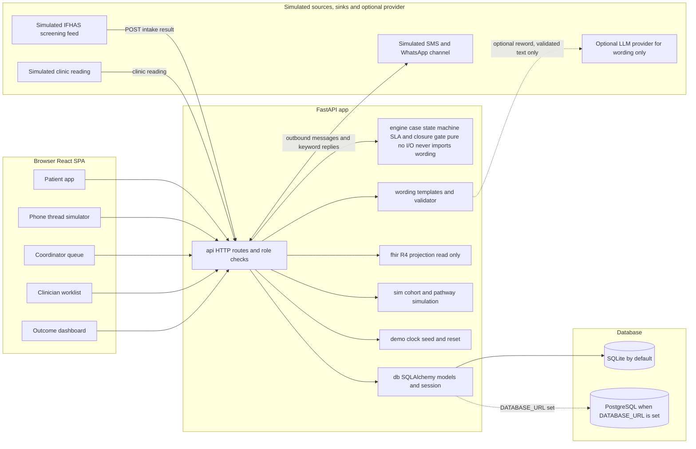
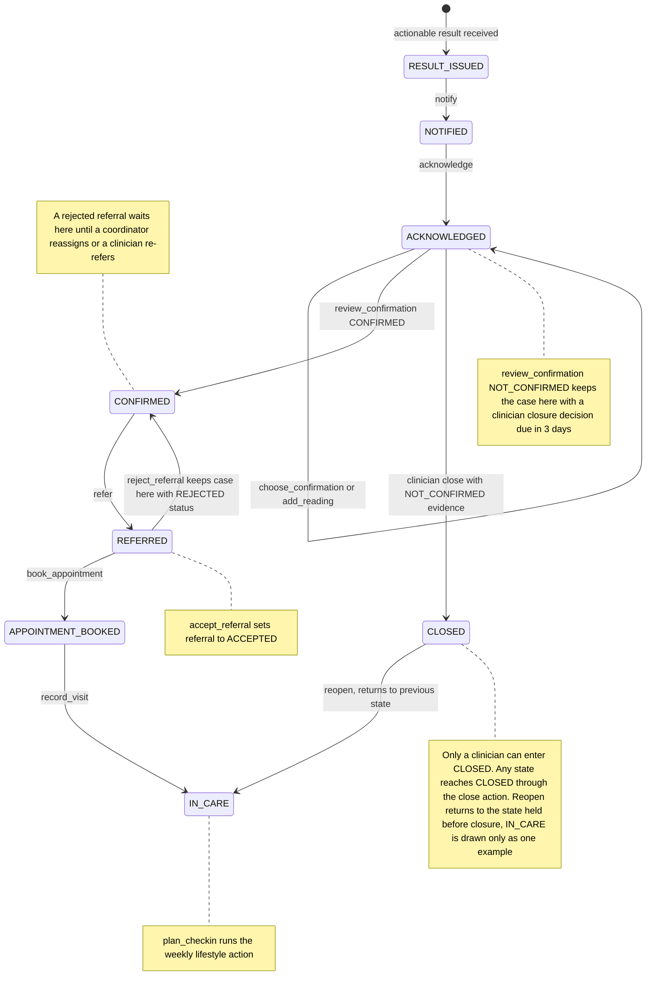
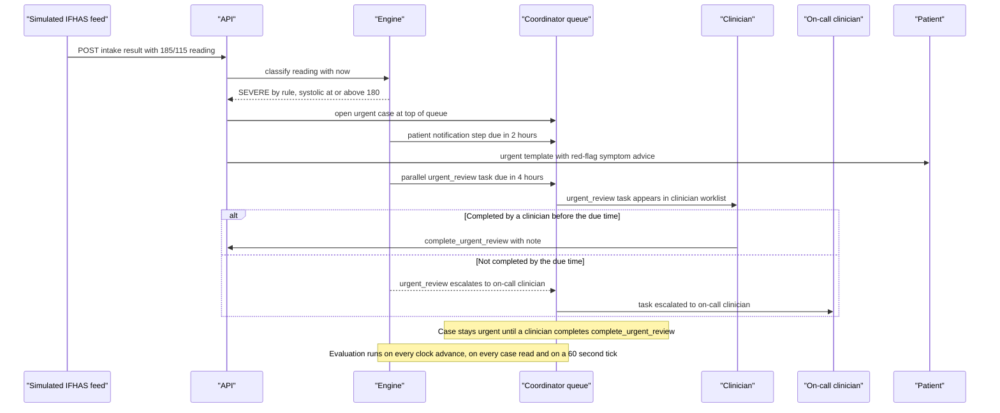
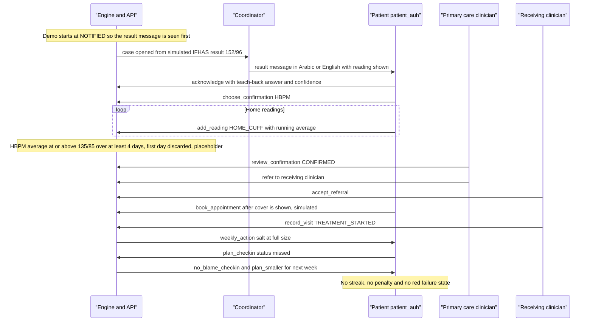
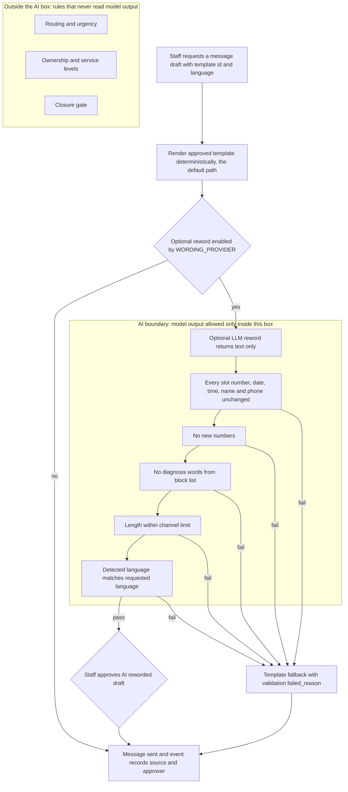
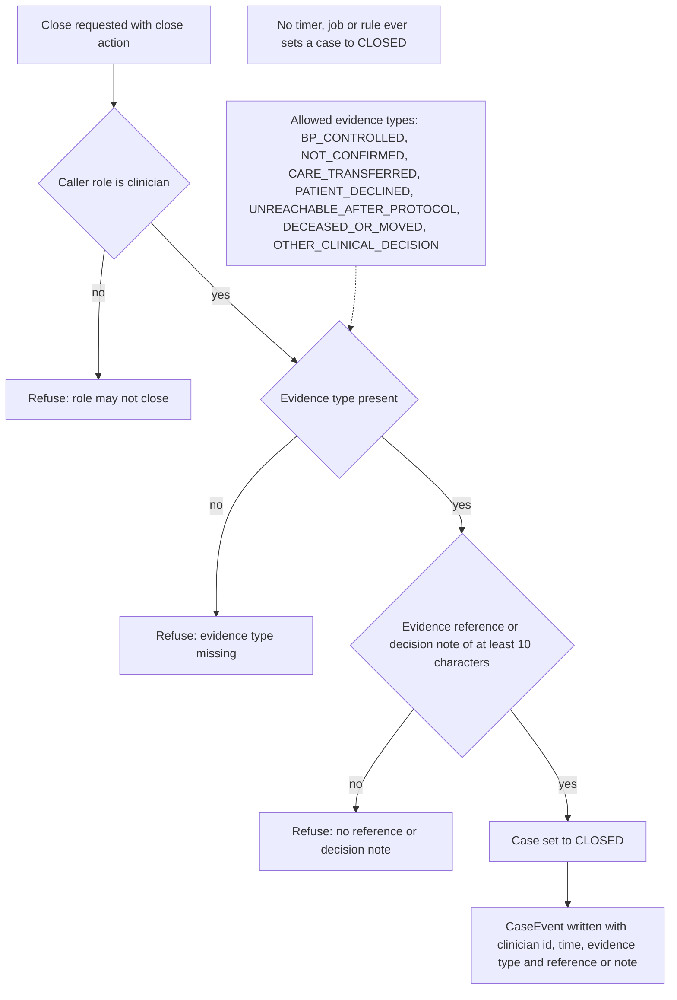

# Halqa diagrams

All diagrams describe the prototype in `docs/SPEC.md`. People, readings, providers and messages are synthetic. Thresholds and service levels are placeholders pending clinician sign-off.

## 1. System architecture

The browser surfaces call one FastAPI app, whose engine is pure rules and never imports the wording module, and only the wording module may reach the optional LLM provider.

## 2. Case lifecycle

The case moves forward through the milestones in SPEC section 4.1, with the action that causes each move written on the transition, and only a clinician can enter CLOSED.

## 3. Ownership and service levels

The table lists each case state with its next step, accountable owner role and default service level, copied from SPEC section 4.1.

| # | State | Next step | Accountable owner role | Default service level |
|---|---|---|---|---|
| 1 | `RESULT_ISSUED` | Notify the patient | coordinator | 24 h (2 h if severe) |
| 2 | `NOTIFIED` | Patient acknowledges and passes teach-back | coordinator | 72 h |
| 3 | `ACKNOWLEDGED` | Complete confirmation by home BP monitoring (HBPM) or ABPM and clinician review of the result | primary care clinician | 14 days |
| 4 | `CONFIRMED` | Send referral | primary care clinician | 3 days |
| 5 | `REFERRED` | Receiving clinician accepts, then appointment is booked | receiving clinician until accepted, then coordinator | 2 days to accept, 5 days to book |
| 6 | `APPOINTMENT_BOOKED` | Visit happens, outcome recorded | receiving clinician | appointment time plus 24 h |
| 7 | `IN_CARE` | Review at 4 weeks; weekly lifestyle action runs here | treating clinician | 28 days |
| 8 | `CLOSED` | none | none | none |

These values are placeholders pending clinician sign-off.

For severe cases a separate urgent_review task, owned by the clinician role and due in 4 hours, runs in parallel with the normal next step and escalates to the on-call clinician if not completed by its due time.

## 4. Severe reading escalation

A 185/115 reading is classed as severe by rule, which sets a 2 hour notification step and a parallel urgent review due in 4 hours that escalates to the on-call clinician if no clinician completes it in time.

## 5. Standard journey

The patient_auh persona goes from a 152/96 screening result through teach-back, home monitoring and referral to a weekly salt action, then a missed week and a no-blame check-in that makes the plan smaller.

## 6. AI boundary

Every message starts from the deterministic template render, and model output can only enter through the optional reword and validator, while routing, urgency, ownership and closure never read it.

## 7. Closure gate

A close request succeeds only when the caller is a clinician and the evidence is complete, and no timer, job or rule ever sets a case to CLOSED.

